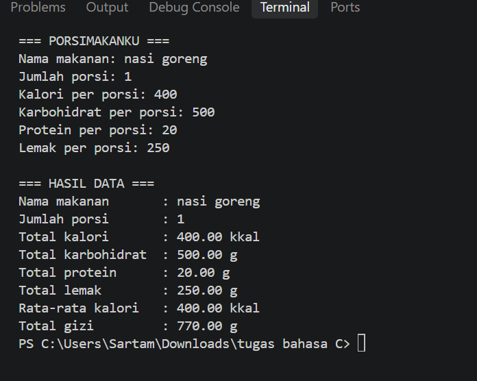

# PORSIMAKANKU
Project Ujian Tengah Semester (UTS) mata pelajaran Pemrograman Dasar /
Koding & Kecerdasan Artifisial kelas X PPLG. Aplikasi ini dibuat dalam
dua versi bahasa pemrograman, yaitu **C** dan **Python**.
## Identitas Siswa
* **Nama Lengkap:** Siti mariyam
* **Kelas:** X PPLG
* **No. Absen:** 33
## Deskripsi Aplikasi
PORSIMAKANKU adalah aplikasi kalkulator gizi sederhana untuk menghitung total kandungan gizi makanan berdasarkan jumlah porsi yang dimakan.Fungsi utamanya adalah membantu pengguna mengetahui berapa total kalori, karbohidrat, protein, dan lemak yang dikonsumsi, agar bisa mengontrol pola makan sehari-hari.Fitur yang ada di dalamnya:
-Input Data Makanan: Memasukkan nama makanan, jumlah porsi, kalori per porsi, karbohidrat per porsi, protein per porsi, dan lemak per porsi.
-Perhitungan Total Gizi: Menghitung total kalori, total karbohidrat, total protein, dan total lemak dengan operator perkalian.
-Rata-rata Kalori: Menghitung rata-rata kalori per porsi dengan operator pembagian.
-Total Gizi: Menjumlahkan total karbohidrat + protein + lemak dengan operator penjumlahan.
-Tampil Hasil: Menampilkan semua hasil perhitungan secara rapi dengan 2 angka di belakang koma.
-Aplikasi ini menggunakan 3 operator aritmatika: * (kali), / (bagi), + (tambah).
## Daftar File
* `nama_file.c` : Kode program utama menggunakan bahasa C.
* `nama_file.py` : Kode program utama menggunakan bahasa Python.
* `output-program.png` : Screenshot hasil menjalankan program aplikasi.
## Screenshot Output Program

